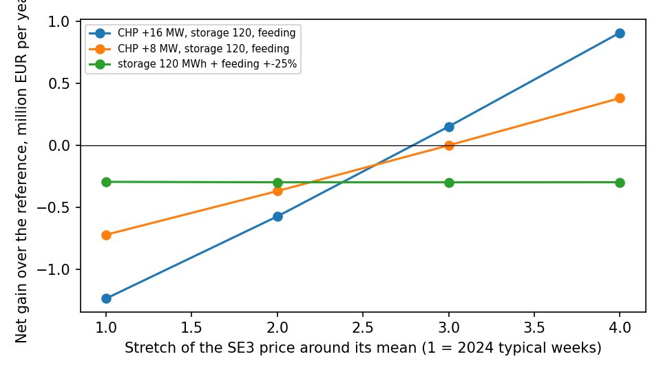

# What is flexible biogas production worth in one Swedish region?

Research study for Östergötland: a Pyomo / HiGHS model of the region's biogas system (raw gas, upgrading to biomethane, CHP, boilers, gas storage, flexible feeding) on 12 typical weeks of hourly SE3 prices, TTF gas and Linköping temperature for each of 2023, 2024 and 2025, crossed with three policy scenarios. It asks what flexibility is worth, how much biogas contributes to regional heat and gas supply, how the system behaves in a supply disruption and what knowing the policy and price scenario in advance is worth.

**One number is published, the rest is assumed.** The regional production of 183 GWh raw biogas in 2024 comes from the Energigas Sverige / Energimyndigheten report; the national shares of use are quoted from the same report. Plant capacities, costs, the heat network, the biomethane price premium and the policy levels are assumptions (`data/sources.csv`). The region is modelled as one aggregated plant with a flat feedstock supply because county feedstock data were not available. Digestion kinetics and digestate are not modelled. The results show mechanisms and orders of magnitude for this setting, not a forecast for the region.

## Question
What is flexible biogas production worth in one Swedish region, and how much does it contribute to regional self-sufficiency and resilience under changing policy and prices?

## Model (`src/biogasflex/model.py`)
Raw gas g_t from the digesters; with flexible feeding it may vary by up to ±25% around the weekly mean (the weekly total is fixed), a raw gas store buffers it (cyclic within the week). Uses: upgrading to biomethane (sold at TTF + 30 EUR/MWh + policy support), CHP (electricity at the SE3 spot price + policy premium, heat sold up to an assumed district heating demand of 3 to 25 MW depending on temperature, about 84 GWh a year), boiler, flare. Unserved heat costs 500 EUR/MWh in the disruption test. Plans are combinations of added upgrading capacity (0, 8, 16 MW), added CHP (0, 8, 16 MW), storage (0, 40, 120 MWh) and flexible feeding (off, ±25%), 54 in all, each with an annualised investment cost (assumed). Scenarios: three price years (2023, 2024, 2025) times three policies (no support; biomethane support of 25 EUR/MWh; that plus a CHP premium of 30 EUR/MWh electricity), nine in all with equal weights. Typical weeks: for each month the week whose mean price is the median of that month's weeks.

## Results
Net profit of the existing system (no additions), million EUR per year: no support 9.7 / 8.8 / 9.2 (2023 / 2024 / 2025); with the biomethane support 13.1 / 12.2 / 12.6; with the CHP premium as well 13.3 / 12.4 / 12.8. The reference system upgrades 140 GWh of the 183 GWh raw gas into 136 GWh of biomethane.

- **Flexible production does not pay in these prices.** Storage of 120 MWh plus feeding flexibility of ±25%, without new conversion capacity, adds only 0.04 million EUR of gross profit a year in 2024 (8.82 against 8.78) and costs 0.33 million a year in annualised investment, a net loss of 0.29 to 0.32 million EUR in all nine scenarios. The reason is where the gas goes: about three quarters is upgraded and sold at a gas-linked price that does not follow the electricity price; the CHP is the only outlet that profits from price spikes, and its electricity beats biomethane only above roughly 120 EUR/MWh, a price that occurs in 295 hours a year in the 2024 typical weeks.
- **Flexibility pays when electricity prices are much more volatile.** Stretching the 2024 SE3 prices around their mean by a factor 3 (1,651 hours above 120 EUR/MWh, peak 735 EUR/MWh) makes the plan with 16 MW more CHP, 120 MWh storage and flexible feeding pay by 0.15 million EUR a year over the reference, and by 0.91 million at a factor 4 (`results/volatility_sensitivity.csv`). The value of flexible biogas is therefore a bet on price volatility, not a property of the plant.
- **One plan is best in every scenario.** The best single plan adds 8 MW of upgrading capacity (expected net 12.27 against 11.56 million EUR for the reference, +0.71 million a year); it is also the best plan in each of the nine scenarios, so the value of perfect information about policy and price scenario is 0 and the regret of the plan is 0 within this plan set. Policy shifts the level of profit by about 3.4 million EUR a year (support) but not the choice of plan.
- **Biogas heat and fuel supply trade off.** The reference system covers 34% of the assumed network heat demand with CHP and boiler heat (30 GWh of 84 in 2024); the plan with more upgrading covers 1.7% and delivers 174 GWh of biomethane instead of 136 GWh. Which of the two counts as the better contribution to self-sufficiency depends on the demands of the region, which are not known here.
- **Resilience is limited by the feedstock, not by the equipment.** In the disruption test the external heat source fails for the cold January week and the feedstock supply falls by 40% in that week. The reference system leaves 52% of the heat demand unserved; boilers of 18 MW instead of 8 MW cut this to 40%; storage, flexible feeding and more CHP change nothing because the energy is not there (`results/outage_test.csv`).



## Data
| Data | Source |
|---|---|
| Raw biogas 2024: 183 GWh, 23 plants, three upgrading units | Energigas Sverige / Energimyndigheten, annual biogas statistics 2024 (`data/raw/biogas_report`) |
| SE3 day-ahead prices 2023-2025 | ENTSO-E Transparency Platform |
| TTF front-month | Yahoo Finance continuous contract (a proxy for the spot price with delivery lag) |
| Temperature at Linköping | Open-Meteo archive (ERA5-based) |

## Limits
- One aggregated plant, flat feedstock supply, 12 typical weeks per price year (they hide price spikes and the seasonality of farm feedstock), no digestion process model, no digestate value. Policy levels, costs, the heat network and the biomethane premium are assumptions. Policy instruments are modelled as price shifts of fixed size, not as the actual Swedish rules.
- The statements about plan choice apply to the 54 plans of the grid and to the stated assumptions only.
- The disruption test is one week and one type of disruption.

## Run
```
pip install -e .
python scripts/download_weather.py
python -m biogasflex.run          # about 10 minutes
python -c "from biogasflex.run import volatility_sensitivity as v; v()"
python -m biogasflex.figures
pytest
```
